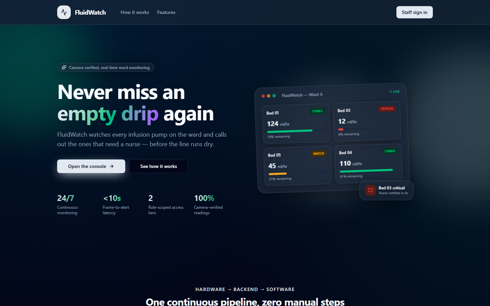
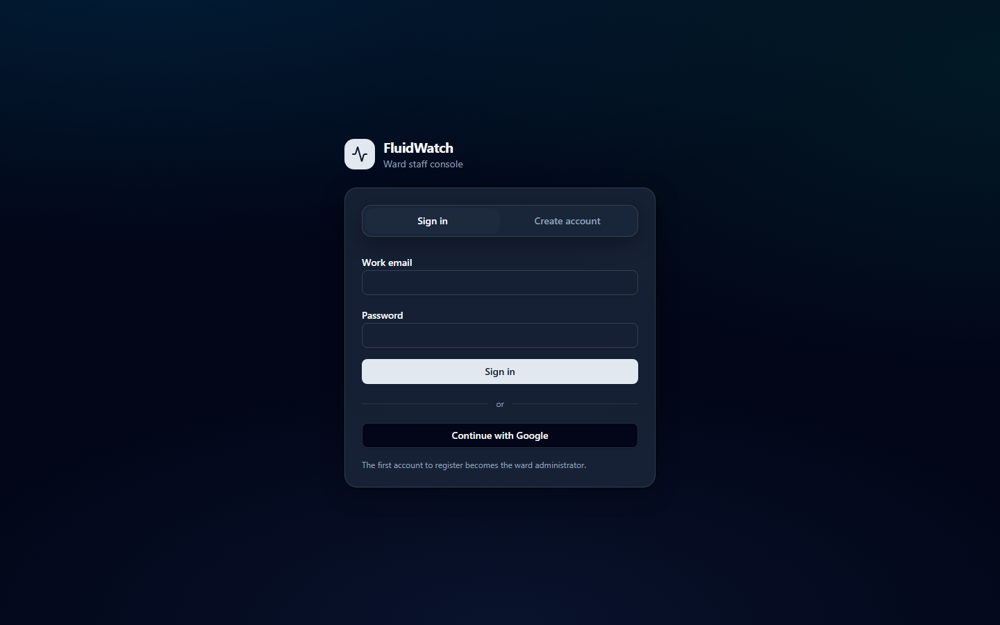
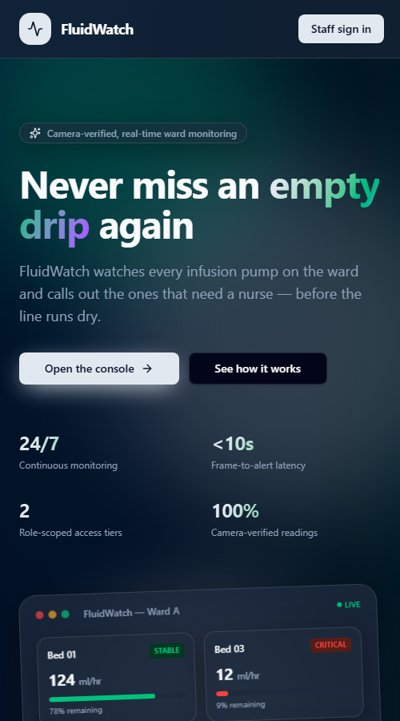

# FluidWatch — Smart IV Drip System

An ESP32-CAM unit mounted on an IV stand photographs the bag on a timer. A
backend scores each photo with a trained fill-level model, derives volume,
flow rate and status, and pushes live updates to a web dashboard that shows
nursing staff every bed and raises an alert when one goes critical.

**Live:** https://frontend-topaz-xi-xu5rpbpic5.vercel.app



<p align="center">
  
  &nbsp;
  
</p>

This README is the project's only documentation file.

- [Repository layout](#repository-layout)
- [How the pieces connect](#how-the-pieces-connect)
- [Quick start (local)](#quick-start-local)
- [Backend — `server/`](#backend--server)
- [Fill-level model — `server/app/cv/` + `ml-model-training/`](#fill-level-model)
- [Team workflow: from first photo to a better model](#team-workflow-from-first-photo-to-a-better-model)
- [Dashboard — `frontend/`](#dashboard--frontend)
- [Database & auth — `supabase/`](#database--auth--supabase)
- [Firmware — `firmware/esp32-cam/`](#firmware--firmwareesp32-cam)
- [Testing & CI](#testing--ci)
- [Security](#security)
- [Deployment](#deployment)

## Repository layout

```
frontend/             Ward dashboard - TanStack Start, React, Tailwind.     -> Vercel
server/               FastAPI backend - ingest, fill-level model, storage,  -> Render
                      exports, WebSocket feeds.
supabase/             Database schema (migrations) for staff auth, roles
                      and ward settings. Supabase CLI project.
firmware/esp32-cam/   ESP32-CAM firmware (PlatformIO) - capture + upload.   -> flashed over USB-serial
ml-model-training/    Training scripts and model artifacts.
.github/              CI workflow and Dependabot config.
docs/screenshots/     Images used in this README.
docker-compose.yml    Runs the backend locally in Docker.
```

Each part is self-contained: its own dependencies, config and ignore rules,
and its own CI job.

## How the pieces connect

```
ESP32-CAM  --HTTP POST image-->  FastAPI (server/)  --WebSocket-->  Dashboard (frontend/)
                                   fill-level model,        /ws/bedfeed    live bed cards
                                   SQLite, CSV/XLSX export                       |
                                                                                 v
                                                              Supabase (supabase/): staff login,
                                                              roles, ward settings
```

- The camera uploads a JPEG to `POST /api/v1/frames`. The server runs the
  model on it, turns the fill % into a full reading (volume, flow rate from
  the previous reading, status and alert), stores it and broadcasts it.
- `server/app/bedfeed.py` reshapes each reading into the
  `{id, bed, patient, fluid, flow, level, status, auxClass, battery, wifi}`
  message that `frontend/src/lib/fluidwatch.ts`'s `applyLiveUpdate()` merges
  into the bed list. A device the dashboard hasn't seen before becomes a new
  bed card automatically, so no provisioning is needed.
- Device statuses map to dashboard statuses: `NORMAL → STABLE`,
  `LOW_LEVEL → WATCH`, `EMPTY`/`OCCLUSION`/`ERROR → CRITICAL`.
- Supabase handles only staff accounts and the `ward_settings` row (alert
  thresholds and the backend's WebSocket URL). The backend never talks to
  Supabase.

## Quick start (local)

**Backend** (Python 3.11):

```sh
cd server
python -m venv .venv
.venv\Scripts\activate              # Windows;  source .venv/bin/activate elsewhere
pip install -r requirements.txt
uvicorn app.main:app --reload --host 0.0.0.0 --port 8000
```

Or with Docker, from the repo root: `API_AUTH_TOKEN=<token> docker compose up --build`.

**Dashboard** (Node 22):

```sh
cd frontend
npm install
npm run dev                         # http://localhost:8080
```

Sign up. **The first account created becomes the ward admin.** Open
`/dashboard` and click **Connect ward server**. Without a live connection the
dashboard runs a built-in simulator on six demo beds, so the UI is never empty.

**Firmware**: see [Firmware](#firmware--firmwareesp32-cam). Without hardware,
open `http://localhost:8000/docs`, use `POST /api/v1/frames` to upload any
photo, and watch it appear on the dashboard.

## Backend — `server/`

FastAPI service that ingests camera frames (and plain JSON readings), runs
the fill-level model, stores readings, exports them, and pushes live updates
over WebSockets.

### Code map

| Path | Role |
|---|---|
| `app/main.py` | App setup, CORS, `/health` |
| `app/config.py` | Settings from env / `.env` (see below) |
| `app/db.py`, `app/models.py`, `app/schemas.py` | SQLAlchemy engine and the `Reading` table / Pydantic shapes |
| `app/routers/frames.py` | `POST /api/v1/frames` - image → model → reading; `GET /latest` serves the last photo |
| `app/routers/readings.py` | JSON ingest, list/latest, CSV/XLSX export, bearer-token auth |
| `app/routers/devices.py` | One row per device from its latest reading, with an online flag (seen in the last 90s) |
| `app/routers/ws.py`, `app/ws_manager.py` | `/ws/readings` and `/ws/bedfeed` broadcast feeds |
| `app/bedfeed.py` | Reading → dashboard bed-card message |
| `app/cv/` | Fill-level model and reading derivation - see [Fill-level model](#fill-level-model) |
| `app/frame_storage.py` | Keeps only the latest JPEG per device (`data/frames/`) |

Readings are capped at 1000 per device (oldest pruned) so storage stays
predictable during long demos.

### Endpoints

| Method & path | Auth | Purpose |
|---|---|---|
| `POST /api/v1/frames?device_id=&bed_label=&patient_name=&fluid_label=` | Bearer | Camera upload (multipart `file`). Runs the model; 422 if the file isn't an image |
| `GET /api/v1/frames/latest?device_id=` | - | Last photo from a device (used by bed cards' ``) |
| `POST /api/v1/readings` | Bearer | JSON reading from a device that measures directly |
| `GET /api/v1/readings?device_id=&limit=` | - | Recent readings, newest first (limit ≤ 5000) |
| `GET /api/v1/readings/latest?device_id=` | - | Most recent reading |
| `GET /api/v1/readings/export.csv` / `.xlsx` | - | Full log, oldest first, for records/EMR hand-off |
| `GET /api/v1/devices` | - | Fleet status: battery, Wi-Fi, last seen, online |
| `WS /ws/bedfeed` | - | Live feed in the dashboard's bed shape |
| `WS /ws/readings` | - | Live feed with the full reading |
| `GET /health`, `GET /docs` | - | Liveness; Swagger UI |

### Configuration

| Variable | Default | Notes |
|---|---|---|
| `API_AUTH_TOKEN` | generated | Required for POSTs. If unset, one is generated on first start and written to `server/.env` (check the startup log). Copy it into the firmware's `secrets.h`. **Always set it explicitly in Docker/Render**, otherwise each fresh container mints a new one and locks the ESP32 out. |
| `DATABASE_URL` | `sqlite:///./data/iv_drip.db` | Any SQLAlchemy URL; Postgres works without code changes |
| `CORS_ORIGINS` | `*` | Comma-separated dashboard origins |
| `SUPABASE_URL`, `SUPABASE_SERVICE_ROLE_KEY` | unset | Turn on the training-data archive (see [Collecting training data](#collecting-training-data)). The service-role/secret key bypasses RLS, so it belongs only in `server/.env` and Render's environment. |

See `server/.env.example`.

## Fill-level model

**What runs:** `server/app/cv/models/fill_regression_v2_mobilenet.pth`, a
MobileNetV3-Small multitask model with a continuous 0–100% regression head
and an auxiliary 4-class head (empty / 50% / 80% / full). Test MAE is about
3.8% and RMSE about 8.9% on the training team's held-out set.

**How it's wired in:**
- `app/cv/base.py` defines the contract: `FrameProcessor.process(device_id, frame_bytes) -> FrameResult(fill_percent, aux_class)`.
- `app/cv/real_frame_processor.py` loads the checkpoint once at startup and
  preprocesses exactly as in training (aspect-preserving resize to 224×224,
  black padding, ImageNet normalization). It returns the regression output
  clamped to 0–100, with the class prediction as `aux_class`. The dashboard
  shows `aux_class` as a sanity badge.
- `app/cv/reading_builder.py` derives everything else from the fill %:
  volume (500 ml bag by default), flow rate from the drop since the
  device's previous reading, time remaining, and status (`EMPTY` ≤ 0.5%,
  `LOW_LEVEL` ≤ 15%).
- `app/cv/pipeline.py`'s `active_processor` selects the implementation.
  `MockFrameProcessor` (random levels) is still there for working without
  the model.

**Dependencies:** `torch`, `torchvision` and `pillow`, installed as
CPU-only wheels via the extra index in `requirements.txt`.

**Caveat:** training labels covered only 0/50/80/100%, so intermediate values
are interpolation. The pipeline is verified end to end, but the model has
**not been validated on real IV-bag photos at scale**. Run a batch of real
photos through `/docs` or `ml-model-training/test_v2.py` before trusting
specific numbers in a demo.

**`ml-model-training/`** holds the training scripts and artifacts:
- `fill_regression_v2_mobilenet.pth` + `_info.json`: the deployed model.
- `train_continuous_v2.py`: trains it.
- `test_v2.py`: the reference inference that `real_frame_processor.py`
  mirrors.
- `fill_classifier_mobilenet.pth` / `train_classifier.py`: the earlier
  4-class classifier (97.4% accuracy) that v2 was initialized from.
- `fluid_line_rf.joblib` / `fluid_line_model.json`: an earlier classical-CV
  prototype, not used.

**To update the model:** retrain with `train_continuous_v2.py`, copy the new
`.pth` into `server/app/cv/models/` (same filename) and restart. Nothing else
changes.

### Collecting training data

The current model was trained on public images and doesn't transfer well to
real ESP32-CAM frames, so the backend can archive every frame it receives into
Supabase as a shared, labelled dataset:

- **Images:** private Storage bucket `training-frames`, stored as
  `<device>/<YYYY-MM-DD>/<device>_<timestamp>.jpg`.
- **Metadata:** table `training_frames`, one row per image. It holds the
  device, time, size, the deployed model's prediction, and the labels
  `label_fill_percent`, `label_yaw_deg`, `session` and `notes`.
- **Labelling at capture time:** before a collection run, edit the single
  row in `capture_settings` (Supabase Table Editor). For example, set
  `label_fill_percent = 80`, `label_yaw_deg = 30`, `session = run-03`.
  Every frame archived from then on carries those labels, within ~10 s of
  the change. Set `enabled = false` to pause archiving. Labels can also be
  corrected per row afterwards.
- **Setup:** set `SUPABASE_URL` and `SUPABASE_SERVICE_ROLE_KEY` on the
  backend (`server/.env` locally, Environment tab on Render). The schema and
  bucket come from `supabase/migrations/20261026120000_training_frames.sql`.
  Archiving runs after the camera's upload has been answered, and a failure
  is only logged, never surfaced to the device.
- **Access for the team:**
  - Project members can browse and download in the Supabase dashboard
    (Storage → `training-frames`, Table Editor → `training_frames`).
  - To pull the dataset for training, run
    `python ml-model-training/fetch_dataset.py --email you@...`. It signs in
    with your own FluidWatch account, which must have the admin role, and
    writes the images plus `labels.csv` to `ml-model-training/dataset/`. Only
    new images are downloaded on each run.

**Capacity on the Supabase Free plan:**
- Storage is 1 GB. Real ESP32-CAM frames (VGA, JPEG quality 12) measured
  12–20 KB each in testing (avg ~15 KB, a dim scene). A well-lit bottle
  with more detail will compress less; expect roughly 25–40 KB. So 1 GB holds
  about 26,000–40,000 well-lit frames, or ~65,000 at the measured size.
- One camera uploading every 10 s produces 8,640 frames/day (~130 MB/day
  measured, ~220–350 MB lit), so continuous capture fills the quota in about
  3–8 days. Pause with `capture_settings.enabled = false` between deliberate
  collection sessions.
- The database is never the limit: 60,000 rows take ~30 MB of the 500 MB.
- Egress is 5 GB/month, shared by everyone. A full download of a 1 GB dataset
  by six people uses 6 GB, so download incrementally, or have one person pull
  it and share it on the team drive.
- Free projects pause after 7 days of inactivity.
- Pro ($25/month) raises storage to 100 GB.

### Training the shared model (team, in turns)

The whole team trains **one** model, one capture session at a time, with
`ml-model-training/shared_training.py`. The model lives in the private
Supabase bucket `models`: a version per training round (`v0001/model.pth`,
`v0002/…`), a `registry.json` holding the history, and a `lock.json` while
someone is training.

```sh
python ml-model-training/shared_training.py status                     # versions, best, who's training
python ml-model-training/shared_training.py init --test-sessions run-07,run-08   # once
python ml-model-training/shared_training.py train --sessions run-04    # your round
python ml-model-training/shared_training.py download                   # best version -> .pth
```

**One `train` round:**
1. **Reserve the model.** If a teammate is mid-round, you're told who and
   until when, and nothing changes.
2. **Start from the current best version.**
3. **Train** on your session(s), plus a replay sample of every session
   trained before, so earlier sessions aren't forgotten.
4. **Score** the new version and the best on the same fixed test sessions.
5. **Save** it as the next version. It becomes best only if it scored better.
   A worse round stays in the history, and the next person continues from
   the best.
6. **Release the lock,** even if the run crashed. If a lock is ever stuck,
   run `unlock`.

**Ground rules:**
- **Test sessions are fixed at `init`,** so every score is comparable. Never
  train on them, and keep them representative: several fill levels and
  yaw angles, captured on a different day.
- **Same recipe as `train_continuous_v2.py`:** architecture, preprocessing,
  losses and augmentation are imported from or mirror the deployed model's
  code. Defaults are 5 epochs, lr 1e-4, batch 24 and replay 1.0.
- **Credentials:** `SUPABASE_URL` and `SUPABASE_SERVICE_ROLE_KEY` in the
  environment or `server/.env`. Supabase project members can copy the
  secret key from Project Settings → API Keys.
- **Shipping a version:** `download --deploy` overwrites
  `server/app/cv/models/fill_regression_v2_mobilenet.pth`. Commit that on the
  `model-training` branch and open a PR to `main`; CI must pass before it
  goes live.
- **Not trained yet:** `label_yaw_deg` is collected, but the current
  architecture has no yaw head.

## Team workflow: from first photo to a better model

The whole team improves **one** model in turns. Each person captures a
labelled session, trains the shared model on it, and the next person
continues from the best version. Nothing is passed around by hand: photos,
labels and every model version live in Supabase.

**Who does what:**
- **Lead (once):** grants access (step 0), picks the test sessions and runs
  `init` (step 4), and ships the best model (step 6).
- **Every teammate:** sets up once (step 1), then repeats steps 2–5 per
  session.

Work on the **`model-training`** branch; `main` is what's deployed.

### 0. Access (lead, once)

1. **GitHub:** add the teammate as a collaborator on the repo.
2. **Supabase:** Organization → Team → **Invite** with the Developer role.
   This lets them use the Table Editor and Storage, and copy the secret key.
3. **Optional:** a FluidWatch dashboard account with the admin role (granted
   at `/admin`). This is only needed for `fetch_dataset.py`, not for
   training.

### 1. Laptop setup (each teammate, once)

```sh
git clone https://github.com/PragnyaKhandelwal/FluidWatch.git
cd FluidWatch
git checkout model-training
git config user.name "Your Name"          # shown in the model history
python -m venv server/.venv
server\.venv\Scripts\activate             # macOS/Linux: source server/.venv/bin/activate
pip install -r server/requirements-dev.txt
```

Create `server/.env`. It's gitignored, so never commit it:

```
SUPABASE_URL=https://gkyynjhflsxebmdgatxd.supabase.co
SUPABASE_SERVICE_ROLE_KEY=<Supabase → Project Settings → API Keys → secret key>
```

Check it works: `python ml-model-training/shared_training.py status`.

### 2. Plan the session

- **One session = one fixed setup:** bottle or bag type, lighting and
  camera position. Change any of them, and start a new session.
- **Name it** `YYYY-MM-DD-<name>-<condition>`, for example
  `2026-10-27-riya-tubelight-500ml`.
- **Full coverage per session:**
  - **Fill levels** 100, 90, 80 … 0 %. Measure them; don't guess. Use the
    volume left ÷ the bottle's capacity × 100, with a syringe or measuring
    cylinder.
  - **Yaw** (bag rotation) of 0, 20, 40, 60 and 80°.
  - **About 2 minutes per level × yaw combination**, which is ~12 photos.
  - That's ~660 photos and about 2 hours per full sweep. A partial sweep is
    fine, as long as the team covers every level across its sessions.
- **Variety across sessions is what makes the model generalise:**
  - lighting: daylight, tube-light, dim, night
  - bottle and bag types, and fluid colours
  - backgrounds
  - small differences in the mount
- **Test sessions:** the lead keeps **1–2 full-coverage sessions, recorded
  on a different day or setup**, as the permanent test set. Nobody ever
  trains on them.

### 3. Capture the session (at the IV stand)

1. **Power the ESP32-CAM and check what it sees:**
   https://sih26-7ru4.onrender.com/api/v1/frames/latest?device_id=IV-CAM-01
   (refresh it; a new photo arrives every ~10 s). The whole bottle should
   be in frame, lit and in focus.
2. **Open Supabase → Table Editor → `capture_settings`** (one row). For each
   level and yaw:
   1. Set `enabled = false` to pause archiving.
   2. Set the bottle to the level (measure it) and rotate it to the yaw.
   3. Fill in `label_fill_percent`, `label_yaw_deg` and `session`, then set
      `enabled = true`.
   4. Wait 10 s, because labels are cached for up to 10 s, then let it
      record for ~2 min.
   5. Go back to step 1 for the next level or yaw.
3. **Rules:**
   - **Never change the bottle while `enabled = true`.** Those photos would
     get the old label.
   - **Keep the drip clamped shut while recording.** A dripping bottle
     drifts away from its label.
4. **When you're done,** set `enabled = false` and clear the label fields.
5. **Spot-check** in Table Editor → `training_frames`, filtered to your
   session: check the counts per level, and open a few images under Storage
   → `training-frames`. For a bad photo (a hand in front, blurred), set its
   `label_fill_percent` to empty. Unlabelled photos are never used for
   training.

### 4. Train your round

**First time only (lead):** once the test sessions are captured and
labelled, run:

```sh
python ml-model-training/shared_training.py init --test-sessions <test-session-1>,<test-session-2>
```

**Every round (the person who captured):**

```sh
git pull                                   # latest tools
python ml-model-training/shared_training.py status
python ml-model-training/shared_training.py train --sessions <your-session>
```

- **"Not now: X is training":** wait. `status` shows who is training and
  until when.
- **What a round does:**
  1. downloads the photos it needs
  2. starts from the **best** version
  3. trains on your session, plus the same number of photos replayed from
     earlier sessions
  4. scores against the test sessions
  5. saves the result as the next version
- **The result line** says `NEW BEST` or `not better`. Both are fine. A worse
  round stays in the history, and the next person starts from the best.
- **Several sessions at once:** `--sessions a,b`.
- **If rounds keep coming out "not better",** try more data first, then
  `--epochs 8` or `--lr 3e-4` / `5e-5`. Every attempt is recorded.
- **Speed:** training runs on a laptop CPU; expect minutes for a few
  thousand photos. A GPU is used automatically if present.

### 5. Hand over

There's nothing to send: the new version is already in Supabase. Post in
the team chat, for example "trained `<session>` → v0007, test MAE 6.2, NEW
BEST". The next person captures their session (step 3) and trains (step 4).

**If a round crashed** and `status` still shows your lock, run
`python ml-model-training/shared_training.py unlock`. Only do this if you're
sure nobody is mid-round.

### 6. Ship the best model (lead)

When the best version's test MAE is clearly better than v0001 (the model
that was deployed at the start):

```sh
python ml-model-training/shared_training.py download --deploy
git add server/app/cv/models/fill_regression_v2_mobilenet.pth
git commit -m "Deploy shared model v00NN (test MAE x.x)"
git push
```

Then open a pull request **`model-training` → `main`** on GitHub. It merges
once all 6 checks pass, and Render then serves the new model. Afterwards,
verify it on the real bottle from the dashboard.

### What decides how good the model gets

- **Correct labels matter more than more photos.** Follow the pause → set →
  resume rule.
- **Variety across sessions** covers lighting, bottles and angles.
- **Fixed, honest test sessions.** Never train on them, and never change
  them after `init`.
- **The best-version rule means the shared model can never get worse** on
  the test set. How good it gets depends on the data.
- **Storage:** pause archiving between sessions. The free 1 GB holds about
  26,000–40,000 lit photos.

## Dashboard — `frontend/`

TanStack Start (React 19, SSR) · TypeScript · Tailwind CSS v4 · shadcn/ui ·
Supabase auth · a raw WebSocket to the backend's `/ws/bedfeed`.

- **Pages:** `/` (landing), `/auth`, and, behind login, `/dashboard`
  (live bed cards), `/analytics` (trends + hardware table from the REST API)
  and `/admin` (staff roles, alert thresholds, backend URL; admins only).
  Routes are files in `src/routes/`; `routeTree.gen.ts` is generated.
- **Live data:** `src/lib/liveBeds.tsx` owns the WebSocket connection
  for the whole signed-in session, so it survives page changes, and raises
  critical alerts (toast + optional beep). The connection URL and alert
  thresholds come from `ward_settings` (`src/lib/wardSettings.ts`), which
  admins edit at `/admin`. `src/lib/fluidwatch.ts` holds the bed model,
  `deriveStatus()` and `applyLiveUpdate()`.
- **PWA:** installable via `public/manifest.webmanifest` and a hand-written
  `public/sw.js`.
- **Scripts:** `npm run dev | build | test | lint | typecheck | format`.
  The lockfile is `bun.lock`; `npm install` works too.

### Environment variables

`frontend/.env` is committed and points at the project's Supabase instance.
The publishable key is safe to expose: it's an RLS-protected anon key.

| Variable | Used by |
|---|---|
| `VITE_SUPABASE_URL`, `VITE_SUPABASE_PUBLISHABLE_KEY`, `VITE_SUPABASE_PROJECT_ID` | Browser bundle (baked in at build time) |
| `SUPABASE_URL`, `SUPABASE_PUBLISHABLE_KEY`, `SUPABASE_PROJECT_ID` | Server-side rendering |

`src/integrations/supabase/client.server.ts` also has a service-role admin
client. Nothing uses it yet; if something does, it needs
`SUPABASE_SERVICE_ROLE_KEY`, which must never reach the browser bundle.

## Database & auth — `supabase/`

`supabase/migrations/` creates:
- `profiles` and `user_roles` (`app_role` enum: `admin` / `nurse`), with RLS
  so only admins can change roles.
- `ward_settings`, a single row with `watch_level`, `critical_level`,
  `min_flow`, `ws_url` and `sound_alerts`, read by the dashboard and edited
  from `/admin`.
- The `handle_new_user` trigger, which creates the profile and makes the
  first signup an admin and everyone after a nurse.

**Using the existing project:** nothing to do. `frontend/.env` already
points at it. When deploying, add the production URL under
**Authentication → URL Configuration** (see below).

**Setting up your own project:**
1. Create a project at [supabase.com](https://supabase.com/dashboard), then
   apply the schema. Either run `supabase link --project-ref <ref>` and
   `supabase db push` from the repo root, or paste each migration into the
   SQL editor in filename order.
2. In **Authentication → URL Configuration**, set **Site URL** to the
   production URL. Add `http://localhost:8080/**`, the production URL plus
   `/**`, and optionally `https://*.vercel.app/**` (for preview deploys) to
   **Redirect URLs**. Email confirmation is on by default; you can turn it
   off under **Providers → Email** for testing.
3. **Google sign-in (optional):**
   1. Enable **Providers → Google** and copy the callback URL it shows
      (`https://<ref>.supabase.co/auth/v1/callback`).
   2. In Google Cloud Console, configure the OAuth consent screen, then
      create a **Web application** OAuth client with that callback as an
      authorized redirect URI.
   3. Paste the client ID and secret back into Supabase.

   Until then, the Google button shows a "Google sign-in failed" toast.
   Email sign-in is unaffected.
4. Copy `frontend/.env.example` to `frontend/.env` and fill in the URL and
   anon key (both the `VITE_` and plain variants) from **Settings → API**.
5. If the backend isn't on `localhost:8000`, set `ward_settings.ws_url`,
   either from `/admin` after signing in or in the SQL editor.

## Firmware — `firmware/esp32-cam/`

Firmware for an AI-Thinker ESP32-CAM (ESP32-D0WDQ6, 4 MB PSRAM, OV5640 5 MP).
It connects to Wi-Fi, captures a JPEG every `SEND_INTERVAL_MS` (10 s by
default) and POSTs it as multipart to `SERVER_URL` with
`device_id/bed_label/patient_name/fluid_label` and the bearer token. It does
no image analysis itself; the server does that.

- **Status LED** (GPIO33, red, next to reset): off while Wi-Fi is
  disconnected, on once connected.
- **Flash LED** (GPIO4): a short blink after each successful capture.
- **Serial** (`pio device monitor`, 115200): logs every upload's HTTP status
  and response. Expect `201`.

### Hardware & flashing

The board has **no USB**, so use an FTDI / USB-TTL adapter and a real 5 V / 2 A+
supply. Weak power is the most common cause of resets and camera-init
failures.

| FTDI | ESP32-CAM |
|---|---|
| 5V | 5V |
| GND | GND |
| TX | U0R |
| RX | U0T |

To flash, tie **GPIO0 to GND** before powering on. Afterwards, remove the
jumper and press reset.

```sh
cd firmware/esp32-cam
cp include/secrets.h.example include/secrets.h   # Wi-Fi, SERVER_URL, API_AUTH_TOKEN, device/bed labels
pio run -t upload
pio device monitor
```

`SERVER_URL` is the full frames endpoint. For local testing that's
`http://<backend LAN IP>:8000/api/v1/frames`; for production it's
`https://<render-app>.onrender.com/api/v1/frames`. `API_AUTH_TOKEN` must
match the backend's exactly. `include/secrets.h` is gitignored.

**Capture tuning:** `include/config.h` (`CAPTURE_FRAME_SIZE`,
`CAPTURE_JPEG_QUALITY`). The model downsizes everything to 224×224, so VGA
(640×480) is plenty unless testing shows otherwise.

`src/camera_bringup_test.cpp.txt` and `src/camera_web_server.cpp.txt` are
standalone bring-up sketches, kept as `.txt` so they aren't built.

**Troubleshooting:**
- **Resets or camera init fails:** check the power supply and wiring first.
- **"no PSRAM found":** check that `BOARD_HAS_PSRAM` in `platformio.ini`
  applied, then do a clean rebuild.
- **Uploads fail:**
  - Check `SERVER_URL` is reachable from the board's network.
  - Check the backend is running.
  - Check the token matches.

## Testing & CI

`.github/workflows/ci.yml` runs on every push and PR to `main`:

| Job | Checks |
|---|---|
| Backend | `ruff` lint (rules in `server/ruff.toml`), then `pytest` in `server/` (63 tests): every endpoint, auth, both WebSocket feeds, exports, reading derivation, path sanitizing, real-model smoke tests |
| Dashboard | `lint`, `typecheck`, Vitest (37 tests for the telemetry logic), production build in `frontend/` |
| Firmware | `pio run` compiles `firmware/esp32-cam` against `secrets.h.example` |
| End-to-end | Builds the backend Docker image, runs it, then `server/e2e/smoke_test.py` drives it from outside: frame upload → model → stored reading → `/ws/bedfeed` message → latest frame, devices, CSV/XLSX |
| Security | See [Security](#security) |

Vercel also builds a preview of every PR. The `main` branch ruleset requires
the Backend, Dashboard, Firmware, End-to-end and Vercel checks to pass before
a PR can merge, and blocks force-pushes and deletion of `main`.

To run the same checks locally:

```sh
cd frontend && npm test && npm run lint && npm run typecheck

cd server
pip install -r requirements-dev.txt
ruff check .
pytest                      # throwaway DB/frames dir; never touches data/ or .env

# from the repo root
API_AUTH_TOKEN=dev-token docker compose up --build
python server/e2e/smoke_test.py --token dev-token
```

## Security

GitHub's built-in code and secret scanning aren't available on this private
repo's plan, so CI's **Security** job covers the same ground for free:

- **Secrets:** [gitleaks](https://github.com/gitleaks/gitleaks) scans the
  entire git history. The only allow-listed value is the Supabase
  publishable (anon) key in `frontend/.env`, which is public by design: it
  ships in the browser bundle, and Row Level Security protects the data
  (`.gitleaks.toml`). Real secrets live only in gitignored files:
  `server/.env` and `firmware/esp32-cam/include/secrets.h`.
- **Vulnerable dependencies:** `pip-audit` (backend) and `bun audit`
  (dashboard; fails on high or critical). `frontend/package.json`
  `overrides` pins patched versions of transitive build-tool packages.
  `torch`/`torchvision` CPU wheels aren't on PyPI, so pip-audit skips them.
- **Dependabot:** weekly update PRs for `frontend/`, `server/` and the CI
  actions (`.github/dependabot.yml`), plus automatic security-fix PRs when
  an advisory lands. torch is excluded from these and upgraded by hand
  against the saved model checkpoint.

Backend API writes require the bearer token (`API_AUTH_TOKEN`); uploaded
device IDs are sanitized before they become file names; corrupt uploads are
rejected with 422.

## Deployment

| Part | Where | Settings |
|---|---|---|
| Dashboard | Vercel, project `frontend` | Root Directory `frontend`, framework TanStack Start. Auto-deploys on push to `main`. Env vars: the six `SUPABASE_*` values from `frontend/.env`. `vite.config.ts` builds Vercel's Build Output API (`.vercel/output/`) via Nitro's `vercel` preset. |
| Backend | Render web service (free tier) | Root Directory `server`. Build `pip install -r requirements.txt`. Start `uvicorn app.main:app --host 0.0.0.0 --port $PORT`. Health check `/health`. Env: `API_AUTH_TOKEN` (set explicitly), `CORS_ORIGINS` = the Vercel origin. `server/render.yaml` mirrors these settings. |
| Firmware | The device | `secrets.h` → `SERVER_URL=https://<render-app>.onrender.com/api/v1/frames` and the same token |

After deploying:
- Set `ward_settings.ws_url` (from `/admin`) to
  `wss://<render-app>.onrender.com/ws/bedfeed`. It has to be `wss://`,
  because browsers block plain `ws://` from an `https://` page.
- Add the Vercel URL to Supabase's redirect URLs.

**Render free-tier notes:**
- The service sleeps after 15 minutes idle and takes 30–60 s to wake.
- SQLite resets on every deploy because there's no persistent disk. For
  durable history, add Render Postgres and set `DATABASE_URL`.
- The torch install makes the first build slow.
