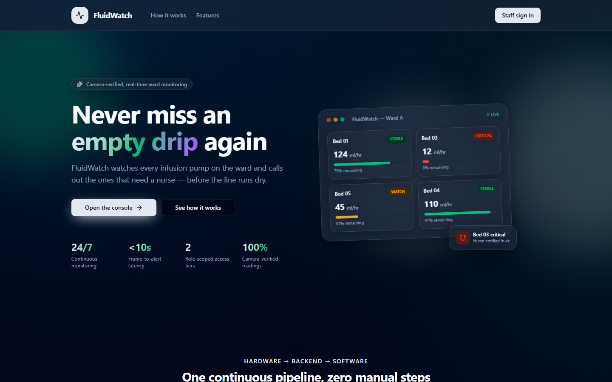
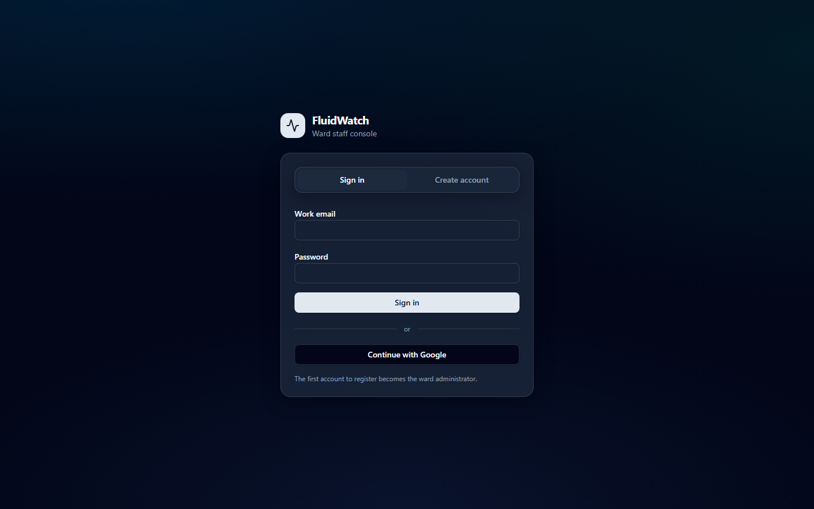
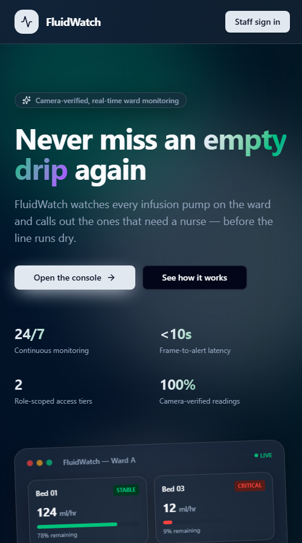

# FluidWatch — Smart IV Drip System

An ESP32-CAM unit mounted on an IV stand photographs the bag on a timer. A
backend scores each photo with a trained fill-level model, derives volume,
flow rate and status, and pushes live updates to a web dashboard that shows
nursing staff every bed and raises an alert when one goes critical.

**Live:** https://frontend-topaz-xi-xu5rpbpic5.vercel.app



<p align="center">
  
  &nbsp;
  
</p>

This README is the project's only documentation file.

- [Repository layout](#repository-layout)
- [How the pieces connect](#how-the-pieces-connect)
- [Quick start (local)](#quick-start-local)
- [Backend — `server/`](#backend--server)
- [Fill-level model — `server/app/cv/` + `ml-model-training/`](#fill-level-model)
- [Dashboard — `frontend/`](#dashboard--frontend)
- [Database & auth — `supabase/`](#database--auth--supabase)
- [Firmware — `firmware/esp32-cam/`](#firmware--firmwareesp32-cam)
- [Testing & CI](#testing--ci)
- [Security](#security)
- [Deployment](#deployment)

## Repository layout

```
frontend/             Ward dashboard - TanStack Start, React, Tailwind.     -> Vercel
server/               FastAPI backend - ingest, fill-level model, storage,  -> Render
                      exports, WebSocket feeds.
supabase/             Database schema (migrations) for staff auth, roles
                      and ward settings. Supabase CLI project.
firmware/esp32-cam/   ESP32-CAM firmware (PlatformIO) - capture + upload.   -> serial once, then OTA
firmware/tools/       fleet.py - remote settings, photos and OTA over MQTT.
ml-model-training/    Training scripts and model artifacts.
.github/              CI workflow and Dependabot config.
docs/screenshots/     Images used in this README.
docker-compose.yml    Runs the backend locally in Docker.
```

Each part is self-contained: its own dependencies, config and ignore rules,
and its own CI job.

## How the pieces connect

```
ESP32-CAM  --HTTP POST image-->  FastAPI (server/)  --WebSocket-->  Dashboard (frontend/)
                                   fill-level model,        /ws/bedfeed    live bed cards
                                   SQLite, CSV/XLSX export                       |
                                                                                 v
                                                              Supabase (supabase/): staff login,
                                                              roles, ward settings
```

- The camera uploads a JPEG to `POST /api/v1/frames`. The server runs the
  model on it, turns the fill % into a full reading (volume, flow rate from
  the previous reading, status and alert), stores it and broadcasts it.
- `server/app/bedfeed.py` reshapes each reading into the
  `{id, bed, patient, fluid, flow, level, status, auxClass, battery, wifi}`
  message that `frontend/src/lib/fluidwatch.ts`'s `applyLiveUpdate()` merges
  into the bed list. A device the dashboard hasn't seen before becomes a new
  bed card automatically, so no provisioning is needed.
- Device statuses map to dashboard statuses: `NORMAL → STABLE`,
  `LOW_LEVEL → WATCH`, `EMPTY`/`OCCLUSION`/`ERROR → CRITICAL`.
- Supabase handles only staff accounts and the `ward_settings` row (alert
  thresholds and the backend's WebSocket URL). The backend never talks to
  Supabase.

## Quick start (local)

**Backend** (Python 3.11):

```sh
cd server
python -m venv .venv
.venv\Scripts\activate              # Windows;  source .venv/bin/activate elsewhere
pip install -r requirements.txt
uvicorn app.main:app --reload --host 0.0.0.0 --port 8000
```

Or with Docker, from the repo root: `API_AUTH_TOKEN=<token> docker compose up --build`.

**Dashboard** (Node 22):

```sh
cd frontend
npm install
npm run dev                         # http://localhost:8080
```

Sign up. **The first account created becomes the ward admin.** Open
`/dashboard` and click **Connect ward server**. Without a live connection the
dashboard runs a built-in simulator on six demo beds, so the UI is never empty.

**Firmware**: see [Firmware](#firmware--firmwareesp32-cam). Without hardware,
open `http://localhost:8000/docs`, use `POST /api/v1/frames` to upload any
photo, and watch it appear on the dashboard.

## Backend — `server/`

FastAPI service that ingests camera frames (and plain JSON readings), runs
the fill-level model, stores readings, exports them, and pushes live updates
over WebSockets.

### Code map

| Path | Role |
|---|---|
| `app/main.py` | App setup, CORS, `/health` |
| `app/config.py` | Settings from env / `.env` (see below) |
| `app/db.py`, `app/models.py`, `app/schemas.py` | SQLAlchemy engine and the `Reading` table / Pydantic shapes |
| `app/routers/frames.py` | `POST /api/v1/frames` - image → model → reading; `GET /latest` serves the last photo |
| `app/routers/readings.py` | JSON ingest, list/latest, CSV/XLSX export, bearer-token auth |
| `app/routers/devices.py` | One row per device from its latest reading, with an online flag (seen in the last 90s) |
| `app/routers/ws.py`, `app/ws_manager.py` | `/ws/readings` and `/ws/bedfeed` broadcast feeds |
| `app/bedfeed.py` | Reading → dashboard bed-card message |
| `app/cv/` | Fill-level model and reading derivation - see [Fill-level model](#fill-level-model) |
| `app/frame_storage.py` | Keeps only the latest JPEG per device (`data/frames/`) |

Readings are capped at 1000 per device (oldest pruned) so storage stays
predictable during long demos.

### Endpoints

| Method & path | Auth | Purpose |
|---|---|---|
| `POST /api/v1/frames?device_id=&bed_label=&patient_name=&fluid_label=` | Bearer | Camera upload (multipart `file`). Runs the model; 422 if the file isn't an image |
| `GET /api/v1/frames/latest?device_id=` | - | Last photo from a device (used by bed cards' ``) |
| `POST /api/v1/readings` | Bearer | JSON reading from a device that measures directly |
| `GET /api/v1/readings?device_id=&limit=` | - | Recent readings, newest first (limit ≤ 5000) |
| `GET /api/v1/readings/latest?device_id=` | - | Most recent reading |
| `GET /api/v1/readings/export.csv` / `.xlsx` | - | Full log, oldest first, for records/EMR hand-off |
| `GET /api/v1/devices` | - | Fleet status: battery, Wi-Fi, last seen, online |
| `WS /ws/bedfeed` | - | Live feed in the dashboard's bed shape |
| `WS /ws/readings` | - | Live feed with the full reading |
| `GET /health`, `GET /docs` | - | Liveness; Swagger UI |

### Configuration

| Variable | Default | Notes |
|---|---|---|
| `API_AUTH_TOKEN` | generated | Required for POSTs. If unset, one is generated on first start and written to `server/.env` (check the startup log). Copy it into the firmware's `secrets.h`. **Always set it explicitly in Docker/Render**, otherwise each fresh container mints a new one and locks the ESP32 out. |
| `DATABASE_URL` | `sqlite:///./data/iv_drip.db` | Any SQLAlchemy URL; Postgres works without code changes |
| `CORS_ORIGINS` | `*` | Comma-separated dashboard origins |
| `SUPABASE_URL`, `SUPABASE_SERVICE_ROLE_KEY` | unset | Turn on the training-data archive (see [Collecting training data](#collecting-training-data)). The service-role/secret key bypasses RLS, so it belongs only in `server/.env` and Render's environment. |

See `server/.env.example`.

## Fill-level model

**What runs:** `server/app/cv/models/fill_regression_v2_mobilenet.pth`, a
MobileNetV3-Small multitask model with a continuous 0–100% regression head
and an auxiliary 4-class head (empty / 50% / 80% / full). Test MAE is about
3.8% and RMSE about 8.9% on the training team's held-out set.

**How it's wired in:**
- `app/cv/base.py` defines the contract: `FrameProcessor.process(device_id, frame_bytes) -> FrameResult(fill_percent, aux_class)`.
- `app/cv/real_frame_processor.py` loads the checkpoint once at startup and
  preprocesses exactly as in training (aspect-preserving resize to 224×224,
  black padding, ImageNet normalization). It returns the regression output
  clamped to 0–100, with the class prediction as `aux_class`. The dashboard
  shows `aux_class` as a sanity badge.
- `app/cv/reading_builder.py` derives everything else from the fill %:
  volume (500 ml bag by default), flow rate from the drop since the
  device's previous reading, time remaining, and status (`EMPTY` ≤ 0.5%,
  `LOW_LEVEL` ≤ 15%).
- `app/cv/pipeline.py`'s `active_processor` selects the implementation.
  `MockFrameProcessor` (random levels) is still there for working without
  the model.

**Dependencies:** `torch`, `torchvision` and `pillow`, installed as
CPU-only wheels via the extra index in `requirements.txt`.

**Caveat:** training labels covered only 0/50/80/100%, so intermediate values
are interpolation. The pipeline is verified end to end, but the model has
**not been validated on real IV-bag photos at scale**. Run a batch of real
photos through `/docs` or `ml-model-training/test_v2.py` before trusting
specific numbers in a demo.

**`ml-model-training/`** holds the training scripts and artifacts:
- `fill_regression_v2_mobilenet.pth` + `_info.json`: the deployed model.
- `train_continuous_v2.py`: trains it.
- `test_v2.py`: the reference inference that `real_frame_processor.py`
  mirrors.
- `fill_classifier_mobilenet.pth` / `train_classifier.py`: the earlier
  4-class classifier (97.4% accuracy) that v2 was initialized from.
- `fluid_line_rf.joblib` / `fluid_line_model.json`: an earlier classical-CV
  prototype, not used.

**To update the model:** retrain with `train_continuous_v2.py`, copy the new
`.pth` into `server/app/cv/models/` (same filename) and restart. Nothing else
changes.

### Collecting training data

The current model was trained on public images and doesn't transfer well to
real ESP32-CAM frames, so the backend can archive every frame it receives into
Supabase as a shared, labelled dataset:

- **Images:** private Storage bucket `training-frames`, stored as
  `<device>/<YYYY-MM-DD>/<device>_<timestamp>.jpg`.
- **Metadata:** table `training_frames`, one row per image. It holds the
  device, time, size, the deployed model's prediction, and the labels
  `label_fill_percent`, `label_yaw_deg`, `session` and `notes`.
- **Labelling at capture time:** before a collection run, edit the single
  row in `capture_settings` (Supabase Table Editor). For example, set
  `label_fill_percent = 80`, `label_yaw_deg = 30`, `session = run-03`.
  Every frame archived from then on carries those labels, within ~10 s of
  the change. Set `enabled = false` to pause archiving. Labels can also be
  corrected per row afterwards.
- **Setup:** set `SUPABASE_URL` and `SUPABASE_SERVICE_ROLE_KEY` on the
  backend (`server/.env` locally, Environment tab on Render). The schema and
  bucket come from `supabase/migrations/20261026120000_training_frames.sql`.
  Archiving runs after the camera's upload has been answered, and a failure
  is only logged, never surfaced to the device.
- **Access for the team:**
  - Project members can browse and download in the Supabase dashboard
    (Storage → `training-frames`, Table Editor → `training_frames`).
  - To pull the dataset for training, run
    `python ml-model-training/fetch_dataset.py --email you@...`. It signs in
    with your own FluidWatch account, which must have the admin role, and
    writes the images plus `labels.csv` to `ml-model-training/dataset/`. Only
    new images are downloaded on each run.

**Capacity on the Supabase Free plan:**
- Storage is 1 GB. At VGA, JPEG quality 12, a frame is roughly 30–60 KB, so
  that's about 17,000–35,000 frames.
- One camera uploading every 10 s produces 8,640 frames/day (~0.3–0.5 GB), so
  continuous capture fills the quota in 2–3 days. Pause with
  `capture_settings.enabled = false` between deliberate collection sessions.
- Egress is 5 GB/month, shared by everyone. A full download of a 1 GB dataset
  by six people uses 6 GB, so download incrementally, or have one person pull
  it and share it on the team drive.
- Free projects pause after 7 days of inactivity.
- Pro ($25/month) raises storage to 100 GB.

## Dashboard — `frontend/`

TanStack Start (React 19, SSR) · TypeScript · Tailwind CSS v4 · shadcn/ui ·
Supabase auth · a raw WebSocket to the backend's `/ws/bedfeed`.

- **Pages:** `/` (landing), `/auth`, and, behind login, `/dashboard`
  (live bed cards), `/analytics` (trends + hardware table from the REST API)
  and `/admin` (staff roles, alert thresholds, backend URL; admins only).
  Routes are files in `src/routes/`; `routeTree.gen.ts` is generated.
- **Live data:** `src/lib/liveBeds.tsx` owns the WebSocket connection
  for the whole signed-in session, so it survives page changes, and raises
  critical alerts (toast + optional beep). The connection URL and alert
  thresholds come from `ward_settings` (`src/lib/wardSettings.ts`), which
  admins edit at `/admin`. `src/lib/fluidwatch.ts` holds the bed model,
  `deriveStatus()` and `applyLiveUpdate()`.
- **PWA:** installable via `public/manifest.webmanifest` and a hand-written
  `public/sw.js`.
- **Scripts:** `npm run dev | build | test | lint | typecheck | format`.
  The lockfile is `bun.lock`; `npm install` works too.

### Environment variables

`frontend/.env` is committed and points at the project's Supabase instance.
The publishable key is safe to expose: it's an RLS-protected anon key.

| Variable | Used by |
|---|---|
| `VITE_SUPABASE_URL`, `VITE_SUPABASE_PUBLISHABLE_KEY`, `VITE_SUPABASE_PROJECT_ID` | Browser bundle (baked in at build time) |
| `SUPABASE_URL`, `SUPABASE_PUBLISHABLE_KEY`, `SUPABASE_PROJECT_ID` | Server-side rendering |

`src/integrations/supabase/client.server.ts` also has a service-role admin
client. Nothing uses it yet; if something does, it needs
`SUPABASE_SERVICE_ROLE_KEY`, which must never reach the browser bundle.

## Database & auth — `supabase/`

`supabase/migrations/` creates:
- `profiles` and `user_roles` (`app_role` enum: `admin` / `nurse`), with RLS
  so only admins can change roles.
- `ward_settings`, a single row with `watch_level`, `critical_level`,
  `min_flow`, `ws_url` and `sound_alerts`, read by the dashboard and edited
  from `/admin`.
- The `handle_new_user` trigger, which creates the profile and makes the
  first signup an admin and everyone after a nurse.
- The training-data archive (`training_frames`, `capture_settings`, bucket
  `training-frames`) and remote device management (`firmware_releases`,
  `device_config`, bucket `firmware`). See
  [Remote management](#remote-management-mqtt--supabase).

**Using the existing project:** nothing to do. `frontend/.env` already
points at it. When deploying, add the production URL under
**Authentication → URL Configuration** (see below).

**Setting up your own project:**
1. Create a project at [supabase.com](https://supabase.com/dashboard), then
   apply the schema. Either run `supabase link --project-ref <ref>` and
   `supabase db push` from the repo root, or paste each migration into the
   SQL editor in filename order.
2. In **Authentication → URL Configuration**, set **Site URL** to the
   production URL. Add `http://localhost:8080/**`, the production URL plus
   `/**`, and optionally `https://*.vercel.app/**` (for preview deploys) to
   **Redirect URLs**. Email confirmation is on by default; you can turn it
   off under **Providers → Email** for testing.
3. **Google sign-in (optional):**
   1. Enable **Providers → Google** and copy the callback URL it shows
      (`https://<ref>.supabase.co/auth/v1/callback`).
   2. In Google Cloud Console, configure the OAuth consent screen, then
      create a **Web application** OAuth client with that callback as an
      authorized redirect URI.
   3. Paste the client ID and secret back into Supabase.

   Until then, the Google button shows a "Google sign-in failed" toast.
   Email sign-in is unaffected.
4. Copy `frontend/.env.example` to `frontend/.env` and fill in the URL and
   anon key (both the `VITE_` and plain variants) from **Settings → API**.
5. If the backend isn't on `localhost:8000`, set `ward_settings.ws_url`,
   either from `/admin` after signing in or in the SQL editor.

## Firmware — `firmware/esp32-cam/`

Firmware for an AI-Thinker ESP32-CAM (ESP32-D0WD-V3, 4 MB PSRAM, OV5640 5 MP,
fixed-focus lens). It connects to Wi-Fi, takes a JPEG every `interval_s`
(10 s by default) and POSTs it as multipart to `SERVER_URL` with
`device_id/bed_label/patient_name/fluid_label` and the bearer token. It does
no image analysis itself; the server does that. Every setting can be changed,
and new firmware installed, remotely over MQTT, so a unit only needs a
programmer once.

| File | Role |
|---|---|
| `src/main.cpp` | Schedule, upload, MQTT command handling, status reports |
| `src/capture_config.cpp` | **The settings table**: every name, range, default and meaning (`fleet.py` reads it too) |
| `src/camera_control.cpp` | Camera power-up / capture / power-down, applying sensor settings |
| `src/remote.cpp` | MQTT over TLS (HiveMQ Cloud), with reconnect backoff and a last-will "offline" status |
| `src/ota.cpp` | Over-the-air install with SHA-256 check and automatic rollback |
| `src/thermal.cpp` | Chip-temperature monitoring and the over-temperature cutoff |
| `include/secrets.h` | Wi-Fi, `SERVER_URL`, `API_AUTH_TOKEN`, MQTT credentials (gitignored) |

- **Status LED** (GPIO33, red, next to reset): on while Wi-Fi is connected.
- **Flash LED** (GPIO4): off, unless the `flash` setting turns it on for captures.
- **Serial** (`pio device monitor`, 115200): boot settings, a full sensor
  report, and every upload's HTTP status. Expect `201`.

### Heat and power

The OV5640 is the hottest part of the board while it streams, so the firmware
keeps it **powered off except for the second or two each photo takes**:
power up, discard `warmup_frames` while exposure and white balance settle,
take the photo, power down (sensor held in hardware power-down via PWDN).
On top of that:

- the CPU runs at `cpu_mhz` = 160 by default (80 is coolest, 240 fastest);
- Wi-Fi modem sleep is on between packets;
- the main loop yields to the idle task instead of spinning;
- `xclk_mhz` can lower the sensor's clock further.

**Thermal protection.** The ESP32's own die temperature is checked every 2 s
(smoothed) and reported everywhere as a read-only metric:

- in `fleet.py status`;
- in every capture and `tune` result;
- as a live bar on the tuning page;
- on the serial log.

What happens at each level:

| Chip temperature | What happens |
|---|---|
| below `temp_cutoff_c` (80 °C) | normal |
| ≥ `temp_cutoff_c` | **cooling**: camera off, no photos, CPU at 80 MHz, until it is 10 °C below the cutoff |
| ≥ `temp_cutoff_c` + 10 °C | **critical**: Wi-Fi and camera off, deep sleep for 10 minutes, then a fresh boot |

Every change is reported as a `thermal` event.

The sensor is uncalibrated (it can be off by about 10 °C) and measures the
silicon, not the camera, so the limits sit well below the chip's 125 °C.
On the classic ESP32 the sensor is powered by the Wi-Fi radio. While modem
sleep has the radio idle, it returns a fixed 53.33 °C. The firmware skips that
value and keeps the radio awake for a few milliseconds per reading. On the
test unit (rev 3.1) this gave real readings: 37 °C at boot, climbing about
1 °C a minute while streaming. If no real reading arrives for a minute, it
reports `thermal: unavailable`, and the cutoff is off until readings return.

### Settings

All of these can be changed remotely (`fleet.py config`), are kept across
reboots, and are listed by `python firmware/tools/fleet.py params`:

| Setting | Range | Default | What it does |
|---|---|---|---|
| `interval_s` | 5..3600 | 10 | Seconds between scheduled photos |
| `cpu_mhz` | 80..240 | 160 | CPU clock: 80, 160 or 240 MHz. Lower = cooler and less power; 160 is the balance |
| `camera_sleep` | 0..1 | 1 | 1 = power the camera off between photos (cooler, safer); 0 = keep it running |
| `xclk_mhz` | 10..20 | 20 | Clock fed to the sensor. Lower runs the sensor cooler but slower; 20 is standard |
| `warmup_frames` | 0..30 | 5 | Frames thrown away after power-up so exposure and white balance settle |
| `settle_ms` | 0..5000 | 100 | Extra wait after power-up before the warm-up frames |
| `flash` | 0..1 | 0 | 1 = white LED on while capturing (even lighting, but can glare on glossy plastic) |
| `temp_cutoff_c` | 50..100 | 80 | Chip temperature that pauses the camera until it cools 10 C; 10 C above it the unit shuts down |
| `frame_size` | 0..21 | 8 | Resolution: QVGA=5 (320x240), VGA=8 (640x480), SVGA=9, XGA=10, HD=11, UXGA=13, QSXGA=21 |
| `jpeg_quality` | 4..63 | 10 | JPEG quality, lower = better and bigger. Below ~8 can overflow at large sizes |
| `brightness` | -2..2 | 0 | Overall brightness offset |
| `contrast` | -2..2 | 0 | Contrast. +1 makes the liquid line stand out more |
| `saturation` | -2..2 | 0 | Colour saturation. Clear fluids need little; coloured fluids may like +1 |
| `sharpness` | -2..2 | 0 | Edge sharpening (not every driver version supports it) |
| `denoise` | 0..8 | 0 | Noise reduction strength (not every driver version supports it) |
| `special_effect` | 0..6 | 0 | 0 none, 1 negative, 2 grayscale, 3 red, 4 green, 5 blue, 6 sepia |
| `awb` | 0..1 | 1 | Auto white balance |
| `awb_gain` | 0..1 | 1 | Apply the auto white balance gains |
| `wb_mode` | 0..4 | 0 | White balance preset when awb_gain is on: 0 auto, 1 sunny, 2 cloudy, 3 office, 4 home |
| `aec` | 0..1 | 1 | Auto exposure. 0 = use aec_value (fixed exposure, most consistent frames) |
| `aec2` | 0..1 | 0 | DSP night mode: longer exposure in low light (slower, may blur drips) |
| `ae_level` | -2..2 | 0 | Auto exposure target: negative = darker, positive = brighter |
| `aec_value` | 0..1200 | 300 | Manual exposure time, used when aec = 0 |
| `agc` | 0..1 | 1 | Auto gain. 0 = use agc_gain |
| `agc_gain` | 0..30 | 0 | Manual gain when agc = 0. Higher = brighter but noisier |
| `gainceiling` | 0..6 | 2 | Max auto gain: 0=2x 1=4x 2=8x 3=16x 4=32x 5=64x 6=128x. Lower = less noise |
| `bpc` | 0..1 | 0 | Black pixel correction |
| `wpc` | 0..1 | 1 | White pixel correction (hides hot pixels) |
| `raw_gma` | 0..1 | 1 | Gamma correction |
| `lenc` | 0..1 | 1 | Lens shading correction (evens out darker corners) |
| `dcw` | 0..1 | 1 | Downsize via the sensor (keep 1 for smaller frame sizes) |
| `hmirror` | 0..1 | 0 | Mirror the image left-right |
| `vflip` | 0..1 | 0 | Flip the image upside down (camera mounted inverted) |
| `colorbar` | 0..1 | 0 | Test pattern instead of the image (diagnostics only) |

Plus the text settings `bed_label`, `patient_name` and `fluid_label` (at most 40
characters each).

**For IV bottles and bags.** Start from the defaults (VGA, quality 10, auto
exposure, camera sleeping between photos), then run `fleet.py tune` with the
unit mounted on a real stand. That takes one photo per preset (resolution,
flash, exposure, contrast, gain, white balance, fixed exposure) without
touching the dataset, so you can compare them side by side. Things to look for:

- **Frame size:** the model letterboxes every frame to 224×224, so VGA is
  enough. SVGA only helps if the bottle is small in the frame.
- **Consistency beats brightness.** Once a good exposure is found, a fixed
  exposure (`aec=0 aec_value=... agc=0 agc_gain=...`) makes every frame look
  the same, which helps the model more than any single setting.
- **`contrast=1`** usually makes the liquid line clearer.
- **`flash=1`** evens out lighting at night, but check for glare on the plastic.
- **Lower `gainceiling`** means less noise in dim wards.
- **Focus:** the lens is fixed-focus. Set it once by turning the lens at the
  mounting distance; no software setting changes it.

### Remote management (MQTT + Supabase)

```
fleet.py (laptop) --MQTT/TLS--> HiveMQ Cloud <--MQTT/TLS-- ESP32-CAM
      |                                                       |
      +--- firmware images, releases, settings ---> Supabase <-+ downloads a signed URL
```

Topics, all under `fluidwatch/<DEVICE_ID>/`: `config` (retained settings),
`cmd` (capture / status / report / reboot / ota), `status` (retained health,
"offline" as the last will), `event` (results) and `photo/<tag>` (tuning shots).

**One-time setup:**
1. **Broker:**
   1. Create a free cluster at [console.hivemq.cloud](https://console.hivemq.cloud).
   2. Under **Access Management**, add credentials for the devices and for
      yourself.
   3. Put the cluster host and the device credentials in
      `firmware/esp32-cam/include/secrets.h` (`MQTT_HOST`, `MQTT_USERNAME`,
      `MQTT_PASSWORD`).
   4. Put the host and your own credentials in `firmware/tools/.env`
      (gitignored):
      ```
      MQTT_HOST=xxxxxxxx.s1.eu.hivemq.cloud
      MQTT_USERNAME=...
      MQTT_PASSWORD=...
      ```
2. **Supabase:** run
   `supabase/migrations/20261109120000_firmware_ota.sql` in the SQL editor.
   It creates:
   - the private `firmware` bucket;
   - `firmware_releases`, one row per version with its SHA-256;
   - `device_config`, each unit's settings.

   `fleet.py` uses the service-role key from `server/.env`.
3. **Install the tool:** `pip install -r firmware/tools/requirements.txt`.
4. **Flash this firmware over serial one last time.** It switches to a
   partition table with two app slots (`min_spiffs.csv`), which OTA needs.

**Day to day** (from anywhere, no programmer):

```sh
python firmware/tools/fleet.py status                       # online units: firmware, Wi-Fi, temperature, last photo
python firmware/tools/fleet.py config IV-CAM-01 contrast=1 bed_label="Bed 12"
python firmware/tools/fleet.py tune IV-CAM-01                # photos per preset -> tune/
python firmware/tools/fleet.py capture IV-CAM-01 --out now.jpg
python firmware/tools/fleet.py release 1.1.0 --notes "..."   # build, upload to Supabase, record SHA-256
python firmware/tools/fleet.py ota IV-CAM-01 1.1.0           # install it remotely
```

**How an update stays safe:**
1. `fleet.py ota` sends the unit a one-hour signed download URL and the image's
   SHA-256 over the authenticated broker.
2. The unit writes the download to its **other** app slot while the current
   firmware keeps running. It only switches if the SHA-256 matches.
3. The new firmware counts as unconfirmed until it reaches the broker. If it
   crash-loops 3 times, or can't connect within 5 minutes, the unit boots the
   previous firmware again and reports `rolled back from ...` in its status.

### Hardware & flashing

The board has **no USB**, so use an FTDI / USB-TTL adapter (voltage jumper on
**5V**) and a real 5 V / 2 A+ supply. Weak power is the most common cause of
resets and camera-init failures.

| FTDI | ESP32-CAM |
|---|---|
| 5V | 5V |
| GND | GND |
| TX | U0R |
| RX | U0T |

To flash:
1. Hold **IO0 to GND** (jumper or button) and tap **RST**. The serial log shows
   `DOWNLOAD_BOOT`.
2. Upload.
3. Release IO0 and tap RST.

```sh
cd firmware/esp32-cam
cp include/secrets.h.example include/secrets.h   # Wi-Fi, SERVER_URL, API_AUTH_TOKEN, MQTT
pio run -t upload
pio device monitor
```

`SERVER_URL` is the full frames endpoint. For local testing that's
`http://<backend LAN IP>:8000/api/v1/frames`; for production it's
`https://<render-app>.onrender.com/api/v1/frames`. `API_AUTH_TOKEN` must
match the backend's exactly. `include/secrets.h` is gitignored.

The repo also has two standalone sketches, kept as `.txt` so they aren't
built. To use one, swap it in for `main.cpp`:
- `src/camera_bringup_test.cpp.txt`: bare camera check.
- `src/camera_web_server.cpp.txt`: tuning page with a live stream. It has a
  control for every setting in the table above, shows the values the sensor
  reports, and generates the matching `fleet.py config` command.

**Troubleshooting:**
- **Resets or camera init fails:** check the power supply and wiring first.
- **Boot loop with `boot:0x33` and `invalid header: 0xffffffff`:** something
  is pulling **IO12** high at power-up, which switches the flash chip to
  1.8 V. Nothing may touch IO12.
- **Upload says "No serial data received":**
  - If the serial log shows `DOWNLOAD_BOOT` but uploads still fail, the
    FTDI TX → U0R wire isn't connected.
  - If nothing arrives at all, check GND and RX ← U0T.
- **"no PSRAM found":** check that `BOARD_HAS_PSRAM` in `platformio.ini`
  applied, then do a clean rebuild.
- **Uploads to the backend fail:**
  - Check `SERVER_URL` is reachable from the board's network.
  - Check the backend is running.
  - Check the token matches.
- **`fleet.py status` shows nothing:**
  - Check the unit's MQTT credentials. The serial log shows
    `[MQTT] connect failed, state=...`, where state 4 or 5 means bad
    credentials.
  - Check the cluster host.

## Testing & CI

`.github/workflows/ci.yml` runs on every push and PR to `main`:

| Job | Checks |
|---|---|
| Backend | `ruff` lint (rules in `server/ruff.toml`), then `pytest` in `server/` (63 tests): every endpoint, auth, both WebSocket feeds, exports, reading derivation, path sanitizing, real-model smoke tests |
| Dashboard | `lint`, `typecheck`, Vitest (37 tests for the telemetry logic), production build in `frontend/` |
| Firmware | `pio run` compiles `firmware/esp32-cam` against `secrets.h.example`; `ruff` + `pytest` for `firmware/tools/fleet.py` (27 tests) |
| End-to-end | Builds the backend Docker image, runs it, then `server/e2e/smoke_test.py` drives it from outside: frame upload → model → stored reading → `/ws/bedfeed` message → latest frame, devices, CSV/XLSX |
| Security | See [Security](#security) |

Vercel also builds a preview of every PR. The `main` branch ruleset requires
the Backend, Dashboard, Firmware, End-to-end and Vercel checks to pass before
a PR can merge, and blocks force-pushes and deletion of `main`.

To run the same checks locally:

```sh
cd frontend && npm test && npm run lint && npm run typecheck

cd server
pip install -r requirements-dev.txt
ruff check .
pytest                      # throwaway DB/frames dir; never touches data/ or .env

# from the repo root
API_AUTH_TOKEN=dev-token docker compose up --build
python server/e2e/smoke_test.py --token dev-token
```

## Security

GitHub's built-in code and secret scanning aren't available on this private
repo's plan, so CI's **Security** job covers the same ground for free:

- **Secrets:** [gitleaks](https://github.com/gitleaks/gitleaks) scans the
  entire git history. The only allow-listed value is the Supabase
  publishable (anon) key in `frontend/.env`, which is public by design: it
  ships in the browser bundle, and Row Level Security protects the data
  (`.gitleaks.toml`). Real secrets live only in gitignored files:
  `server/.env` and `firmware/esp32-cam/include/secrets.h`.
- **Vulnerable dependencies:** `pip-audit` (backend) and `bun audit`
  (dashboard; fails on high or critical). `frontend/package.json`
  `overrides` pins patched versions of transitive build-tool packages.
  `torch`/`torchvision` CPU wheels aren't on PyPI, so pip-audit skips them.
- **Dependabot:** version updates once a month (the 1st, 09:00 IST) for
  `frontend/`, `server/`, `firmware/tools/` and the CI actions
  (`.github/dependabot.yml`).
  - Each component gets one grouped PR. Frontend major bumps come as their
    own PRs. Updates raise the minimum version in the manifest itself
    (`versioning-strategy: increase`).
  - Anything that isn't a major bump **merges itself** once all required
    checks pass (`.github/workflows/dependabot-auto-merge.yml`; needs
    **Settings → General → Allow auto-merge**). Only majors need a person.
  - Security-fix PRs are separate, still open as soon as an advisory lands,
    and auto-merge the same way.
  - torch is excluded from these and upgraded by hand against the saved
    model checkpoint.

Backend API writes require the bearer token (`API_AUTH_TOKEN`); uploaded
device IDs are sanitized before they become file names; corrupt uploads are
rejected with 422.

## Deployment

| Part | Where | Settings |
|---|---|---|
| Dashboard | Vercel, project `frontend` | Root Directory `frontend`, framework TanStack Start. Auto-deploys on push to `main`. Env vars: the six `SUPABASE_*` values from `frontend/.env`. `vite.config.ts` builds Vercel's Build Output API (`.vercel/output/`) via Nitro's `vercel` preset. |
| Backend | Render web service (free tier) | Root Directory `server`. Build `pip install -r requirements.txt`. Start `uvicorn app.main:app --host 0.0.0.0 --port $PORT`. Health check `/health`. Env: `API_AUTH_TOKEN` (set explicitly), `CORS_ORIGINS` = the Vercel origin. `server/render.yaml` mirrors these settings. |
| Firmware | The device | `secrets.h` → `SERVER_URL=https://<render-app>.onrender.com/api/v1/frames` and the same token |

After deploying:
- Set `ward_settings.ws_url` (from `/admin`) to
  `wss://<render-app>.onrender.com/ws/bedfeed`. It has to be `wss://`,
  because browsers block plain `ws://` from an `https://` page.
- Add the Vercel URL to Supabase's redirect URLs.

**Render free-tier notes:**
- The service sleeps after 15 minutes idle and takes 30–60 s to wake.
- SQLite resets on every deploy because there's no persistent disk. For
  durable history, add Render Postgres and set `DATABASE_URL`.
- The torch install makes the first build slow.
